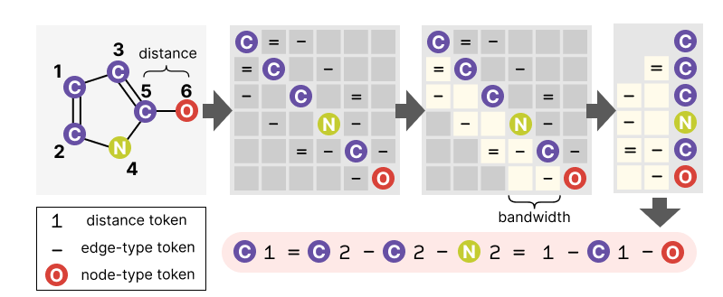

# SNACK

> **SNACK: A Sequential Notation Framework for Probabilistic Graph Generation**

Hohyun Kim\* &nbsp;|&nbsp; Hyesung Kim\* &nbsp;|&nbsp; Min-hwan Oh &nbsp;|&nbsp; Seunggeun Lee

Neural Information Processing Systems (NeurIPS), 2026

[](https://arxiv.org/abs/2610.19781)
[](https://arxiv.org/pdf/2610.19781)

---

<p align="center">
   
</p>

🍿 **SNACK** represents discrete graphs as compact strings using four basic elements. For example, in molecular graphs:

- Node type: Atom type (C, N, O, ...)
- Edge type: Bond type (-, =, #, ...)
- Attributes: Formal charge, hydrogen count, chirality, isotope, ...
- Distance: Difference between the node indices of connected atoms (1, 2, 3, ...)

🍿 **SNACK** encodes graphs as sequences of tokens in the following order:

`Node type → (Node attributes) → Distance → Edge type → (Edge attributes) → Node type`

For example, **CH₂=NH₂⁺** is encoded as:

```python
import snack as snk

print(snk.smiles_to_snack('C=[NH2+]', ordering=None))
```

```text
C1=N(+)
```

where:

- **`C`** and **`N`**: Node types.
- **`1`**: Distance between two nodes, calculated as the difference between their node indices.
- **`=`**: Edge type (double bond).
- **`(+)`**: Node attribute (positive formal charge).
- **Implicit hydrogens**: Hydrogen atoms are omitted and inferred from the molecular structure.

Node and edge attributes are optional and included only when needed.

`N(+)` can be split into separate tokens (`N` and `(+)`) or treated as a single
token (`N(+)`). The paper uses the latter approach.

Generic graphs use `o` for an untyped node and `-` for an untyped edge:

```python
import networkx as nx
import snack as snk

print(snk.graph_to_snack(nx.path_graph(3)))
```

```text
o1-o1-o
```


## Installation

`snack-graph` offers helper utilities to convert between:

- **SMILES / RDKit molecules** ↔ **SNACK strings**
- **NetworkX graphs** ↔ **SNACK strings**

```bash
pip install --upgrade snack-graph
```

Requires **Python 3.10+**, `networkx`, `pynauty`, and `rdkit`. PyTorch and
pandas are not required. Install as `snack-graph`; import as `snack`.

**Upgrading from 0.1:** 1.x changes the notation and token IDs. For example,
`[C]1-[O]` becomes `C1-O`, and `v1_v` becomes `o1-o`. Re-encode original
graphs or molecules and rebuild tokenized datasets. Use `snack-graph==0.1.0`
to keep working with the old notation.

[Notation](#notation) · [Examples](#examples) ·
[Ordering and formatting](#ordering-and-formatting) · [Datasets](#bundled-datasets)

## Notation


| Element | Spelling | Notes |
| --- | --- | --- |
| Atom | `C`, `Cl`, `Fe`, `*` | Element symbol, no brackets; every element is supported. |
| Node | `o` | A node with no type, for generic graphs. |
| Distance | `1`, `2`, ... | Number of nodes back to the neighbor. |
| Bond | `-`, `=`, `#`, `a` | Single, double, triple, aromatic. `-` is the plain edge of a generic graph. |
| Isotope | `(2)`, `(13)`, `(235)`, ... | After the atom, before the others. The bare mass number: `C(13)` is carbon-13. |
| Charge | `(+)`, `(-)`, `(+2)`, `(-3)`, ... | After the atom. `+2` rather than `++`. |
| Hydrogens | `(H0)`, `(H)`, `(H2)`, ... | After the atom. Written only when the count cannot be inferred: `C` is `C(H4)`. |
| Chirality | `(@)`, `(@@)` | After the atom. SMILES meaning with neighbors ordered by node index. |
| Cis/trans | `(c)`, `(t)` | After a `=` bond. Local cis/trans of the lowest-index substituents. |
| Anything else | `(weight=3)`, `(node_type=hub)` | One token per node or edge data entry, sorted by name, after the attributes above. |

Atom attributes are written in the fixed order isotope → charge → hydrogens →
chirality, each at most once, so `N(15)(+)(H)(@)` is valid and `N(@)(+)` is
not; the mass number comes first, as it does in a SMILES bracket atom.
Radicals are not written: an atom with fewer hydrogens than its valence allows
carries its hydrogen count instead (`[CH2]C` is `C(H2)1-C`), and RDKit restores
the unpaired electrons on decoding. Atom map numbers are not supported.

## Usage

| Function | Purpose |
| --- | --- |
| `smiles_to_snack()` / `snack_to_smiles()` | Convert between SMILES and SNACK strings. |
| `mol_to_snack()` / `snack_to_mol()` | Convert between RDKit molecules and SNACK strings. |
| `smiles_to_graph()` / `graph_to_smiles()` | Convert between SMILES and NetworkX graphs. |
| `mol_to_graph()` / `graph_to_mol()` | Convert between RDKit molecules and NetworkX graphs. |
| `graph_to_snack()` / `snack_to_graph()` | Convert between NetworkX graphs and SNACK strings. |
| `graph_to_tokens()` / `tokens_to_graph()` | Convert between NetworkX graphs and lists of SNACK tokens. |
| `split()` | Split a SNACK string into tokens, distance–bond pairs, or node blocks. |
| `filter()` | Extract node, distance, bond or attribute tokens from a SNACK string. |
| `is_canonical_snack()` | Check that every stereo mark and hydrogen count in a string is necessary. |
| `SnackTokenizer()` | Create the general molecular tokenizer, or the `graph`, `qm9` or `moses` preset. |
| `tokenizer.encode()` / `tokenizer.decode()` | Convert between SNACK strings and integer token IDs. |
| `tokenizer.get_logit_mask()` | Return an allowed-next-token mask after each token in a sequence. |
| `count_automorphisms()` | Count graph symmetries, respecting node types, molecular attributes, edge types and weights; optionally preserve stereo. |
| `canonicalize_smiles()` / `randomize_smiles()` | Produce canonical SMILES or an alternative SMILES for the same molecule. |
| `load_dataset()` | Load a bundled generic-graph dataset as `train`, `val`, and `test` SNACK-string lists. |

## Examples

### 1) SMILES → SNACK → SMILES

`smiles_to_snack()` uses randomized BFS by default. Set a random seed for
reproducible sequences, or use `ordering=None` to preserve input atom order.

```python
import random
import snack as snk

random.seed(0)
smiles = "CC(=O)Oc1ccccc1C(=O)O"  # aspirin
sn = snk.smiles_to_snack(smiles)

print("snack:", sn)
print("smiles:", snk.snack_to_smiles(sn))
```

```text
snack: C1=C2-C2-C2=C2=1-C2-O2-C2-C2=O3-O3=O4-C
smiles: CC(=O)Oc1ccccc1C(=O)O
```

### 2) Charges, hydrogen counts and stereochemistry

Supported molecular attributes are preserved by default.

```python
import snack as snk

examples = [
    "C[C@H](N)C(=O)O", "F/C=C/F", "C[N+](C)(C)C", "[13CH3]C", "[CH2]C",
]
for smiles in examples:
    sn = snk.smiles_to_snack(smiles, ordering=None)
    print(f"{smiles:18} {sn:32} {snk.snack_to_smiles(sn)}")
```

```text
C[C@H](N)C(=O)O    C1-C(@)1-N2-C1=O2-O              C[C@H](N)C(=O)O
F/C=C/F            F1-C1=(t)C1-F                    F/C=C/F
C[N+](C)(C)C       C1-N(+)1-C2-C3-C                 C[N+](C)(C)C
[13CH3]C           C(13)1-C                         C[13CH3]
[CH2]C             C(H2)1-C                         [CH2]C
```

Hydrogen counts are inferred from the element, bonds and charge.
An `(H...)` token is written only when that inference would give a different
count, as for the radical `C(H2)` above. RDKit checks valence on decoding.

### 3) Choosing which attributes to keep

`attributes` selects any subset of `isotope`, `charge`, `hydrogens`,
`chirality` and `cis_trans`. Excluding an attribute removes that information:
for example, omitting `chirality` loses the specified handedness of a center.
Keep all attributes when molecular identity must be preserved.

```python
import snack as snk

smiles = "C[13C@H]([NH3+])C(=O)[O-]"
for attributes in (None, ("isotope",), ("charge", "hydrogens"), ()):
    sn = snk.smiles_to_snack(smiles, ordering=None, attributes=attributes)
    print(f"{str(attributes):26} {sn:44} {snk.snack_to_smiles(sn)}")
```

```text
None                       C1-C(13)(@)1-N(+)2-C1=O2-O(-)                C[13C@H]([NH3+])C(=O)[O-]
('isotope',)               C1-C(13)1-N2-C1=O2-O                         C[13CH](N)C(=O)O
('charge', 'hydrogens')    C1-C1-N(+)2-C1=O2-O(-)                       CC([NH3+])C(=O)[O-]
()                         C1-C1-N2-C1=O2-O                             CC(N)C(=O)O
```

### 4) Aromatic or kekule form

Molecules are kekulized by default, so an aromatic ring alternates `-` and
`=`. Pass `kekulize=False` to keep RDKit's aromatic bonds and write them as
`a`. Both forms decode to the same molecule.

```python
import snack as snk

for kekulize in (True, False):
    sn = snk.smiles_to_snack("c1ccccc1", ordering=None, kekulize=kekulize)
    bonds = sorted(set(snk.filter(sn, key="edge_type")))
    print(kekulize, bonds, snk.snack_to_smiles(sn))
```

```text
True ['-', '='] c1ccccc1
False ['a'] c1ccccc1
```

### 5) Molecules as NetworkX graphs

Graphs store the attributes under the same names. `attributed=False`
keeps only connectivity.

```python
import snack as snk

G = snk.smiles_to_graph("C[N+](C)(C)C")
print(G.nodes(data=True))
print(G.edges(data=True))
print(snk.graph_to_snack(G))
print(snk.graph_to_snack(G, attributed=False))
```

```text
[(0, {'node_type': 'C'}), (1, {'node_type': 'N', 'charge': 1}), (2, {'node_type': 'C'}), (3, {'node_type': 'C'}), (4, {'node_type': 'C'})]
[(0, 1, {'edge_type': '-'}), (1, 2, {'edge_type': '-'}), (1, 3, {'edge_type': '-'}), (1, 4, {'edge_type': '-'})]
C1-N(+)1-C2-C3-C
o1-o1-o2-o3-o
```

Chirality is stored as `chirality=(ligands, '@'|'@@')` with ligands listed
as node IDs (`None` for an implicit H or lone pair), and cis/trans as
`cis_trans=((u, ref_u), (v, ref_v), 'c'|'t')`. Both are independent of the
node order, so any `ordering` serializes correctly. `graph_to_mol()` raises
`ValueError` for invalid valence or unsupported bond types.

### 6) Splitting SNACK strings

```python
import snack as snk

sn = "C1-C(@)1-N(+)(H)2-C1=(t)C1-O(-)"
print(snk.split(sn, pattern="token"))
print(snk.split(sn, pattern="graph"))
print(snk.split(sn, pattern="block"))
print(snk.filter(sn, key="node_type"))
print(snk.filter(sn, key="attribute"))
print([snk.token_type(t) for t in snk.split(sn)][:8])
```

```text
['C', '1', '-', 'C', '(@)', '1', '-', 'N', '(+)', '(H)', '2', '-', 'C', '1', '=', '(t)', 'C', '1', '-', 'O', '(-)']
['C', '1-', 'C(@)', '1-', 'N(+)(H)', '2-', 'C', '1=(t)', 'C', '1-', 'O(-)']
['C', '1-C(@)', '1-N(+)(H)', '2-C', '1=(t)C', '1-O(-)']
['C', 'C', 'N', 'C', 'C', 'O']
['(@)', '(+)', '(H)', '(t)', '(-)']
['node_type', 'distance', 'edge_type', 'node_type', 'attribute', 'distance', 'edge_type', 'node_type']
```

### 7) Decoding modes and canonical strings

A stereo mark counts as a stereo element when RDKit's SMILES writer keeps
it. By default decoding drops the other marks (`stereo="clean"`);
`stereo="strict"` raises instead. `is_canonical_snack()` reports whether a
string carries only necessary marks and hydrogen counts.

```python
import snack as snk

text = "C1-C(@)1-C2-C"  # a center with two methyl groups is not stereogenic
print(snk.snack_to_smiles(text), snk.is_canonical_snack(text))
try:
    snk.snack_to_smiles(text, stereo="strict")
except ValueError as e:
    print("strict:", e)
print(snk.is_canonical_snack("C(H4)"), snk.is_canonical_snack("C(H2)1-C"))
```

```text
CC(C)C False
strict: Invalid molecular graph: Stereo annotations on non-stereogenic nodes [1] or bonds []
False True
```

### 8) Tokenizer presets

Choose `"mol"` for general molecules, `"graph"` for untyped graphs, or a
dataset preset:

| Preset | Tokens | Node types | Default node limit | Attributes |
| --- | ---: | --- | ---: | --- |
| `"mol"` (default) | 575 | All elements and `*` (unspecified atom) | 128 | All five kinds |
| `"graph"` | 132 | `o` (untyped node) | 128 | none |
| `"qm9"` | 20 | C, F, N, O | 9 | charge ±1 |
| `"moses"` | 38 | Br, C, Cl, F, N, O, S | 26 | none |

`encode()` adds `[bos]` and `[eos]`; `decode()` removes special tokens.
`max_nodes` sets the node limit and the distance range (1–127 for the default
128 nodes). Molecular presets use the Kekulé bonds `-`, `=`, and `#`.
To encode aromatic `a` bonds directly, pass `edge_types=("-", "=", "#", "a")`.

Use `attributes` to choose attribute kinds. For example, excluding `isotope`
removes the 294 mass-number tokens `(1)` through `(294)`, reducing the
`mol` vocabulary from 575 to 281 tokens. Keep those tokens if your data
contains isotope labels you want to preserve.

The 0.1 presets `zinc250k` and `guacamol` are no longer provided; use `mol`
and restrict generation with `allowed_node_types` / `allowed_edge_types`.

```python
import snack as snk

tokenizer = snk.SnackTokenizer()
print(len(tokenizer), tokenizer.max_nodes)
print(tokenizer.tokens[:5], tokenizer.tokens[-6:])
ids = tokenizer.encode("C1-O(-)")
print(ids, tokenizer.decode(ids))
```

```text
575 128
('[pad]', '[bos]', '[eos]', 'H', 'He') ('(H7)', '(H8)', '(@)', '(@@)', '(c)', '(t)')
[1, 8, 122, 249, 10, 553, 2] C1-O(-)
```

### 9) Generation masks

Masks enforce the grammar, connectivity, the node limit and RDKit valence:
bonds and hydrogens may not exceed what the element and charge allow, and
`[eos]` is offered only when RDKit sanitizes the molecule.
Accepted valence states follow the installed RDKit version.

```python
import snack as snk

tokenizer = snk.SnackTokenizer(max_nodes=6)

def allowed(text):
    return sorted(tokenizer.tokens[i] for i in tokenizer.allowed_next_ids(tokenizer.encode(text)[:-1]))

print(allowed("O1"))
print("[eos]" in allowed("C1-C1-C3-2-1=N(+)"))
```

```text
['-', '=']
True
```

Use `allowed_node_types` / `allowed_edge_types` to restrict generation to a
subset (for example organic elements) without changing token IDs,
`allow_disconnected=True` for salts and mixtures, `ordering="bfs"` to
restrict generation to BFS order, and `valence=False` to keep only the
grammar checks. `encode(text, validate=True)` checks a string against the
same masks.

### 10) Graph tokenization and sequence masks

Use `SnackTokenizer("graph")` for untyped graphs. `get_logit_mask()` returns
one row per position describing what may come
next. Columns follow `tokenizer.tokens`. For training, row `i` predicts
`ids[i + 1]`; before sampling, set logits to `-inf` where the mask is `False`.

```python
import snack as snk

tokenizer = snk.SnackTokenizer("graph", ordering="bfs", max_nodes=2)
ids = tokenizer.encode("o1-o")
masks = tokenizer.get_logit_mask(ids[:-1])

print("ids:", ids)
print("decoded:", tokenizer.decode(ids))
print("vocabulary:", tokenizer.tokens)
for position, prefix in enumerate(["BOS", "o", "o1", "o1-"]):
    print(f"after {prefix}:", masks[position])
```

```text
ids: [1, 3, 4, 5, 3, 2]
decoded: o1-o
vocabulary: ('[pad]', '[bos]', '[eos]', 'o', '1', '-')
after BOS: [False, False, False, True, False, False]
after o: [False, False, True, False, True, False]
after o1: [False, False, False, False, False, True]
after o1-: [False, False, False, True, False, False]
```

### 11) Incremental generation

```python
import random
import snack as snk

tokenizer = snk.SnackTokenizer(max_nodes=12, ordering="bfs", allowed_node_types=["C", "N", "O"], attributes=())
rng = random.Random(0)
state, ids = tokenizer.new_state(), []
while True:
    allowed = tokenizer.allowed_token_ids(state)
    if len(state.nodes) < 8 and len(allowed) > 1:  # prefer growing the molecule
        allowed = [i for i in allowed if i != tokenizer.eos_id]
    choice = rng.choice(allowed)
    tokenizer.step(state, choice)
    ids.append(choice)
    if choice == tokenizer.eos_id:
        break
text = tokenizer.decode(ids)
print(text)
print(snk.snack_to_smiles(text))
```

```text
N1=O2-N1=O
O=NN=O
```

Completed sequences ending in `[eos]` pass RDKit sanitization when valence
checks are enabled. If no tokens are allowed, backtrack or restart generation.
Generated stereo marks may be unnecessary; filter with `is_canonical_snack()`.

### 12) Automorphisms and graph attributes

`count_automorphisms()` respects node types, isotopes, charges, hydrogen
counts, bond types and edge weights. `stereo=True` additionally respects
chirality and cis/trans. For meso 2,3-butanediol, this gives 1 instead of 2:

```python
import snack as snk

G = snk.smiles_to_graph("O[C@@H](C)[C@@H](C)O")
print(snk.count_automorphisms(G), snk.count_automorphisms(G, stereo=True))
```

```text
2 1
```

Any other node or edge data is written as one `(key=value)` token per entry,
sorted by name, after the compact attributes. Values may be integers, real
numbers or strings; a node or edge type with no bare token, such as a label,
uses the same form.

```python
import networkx as nx
import snack as snk

G = nx.Graph()
G.add_node(0, node_type="hub", size=2)
G.add_node(1)
G.add_edge(0, 1, edge_type="knows", weight=3.5)

text = snk.graph_to_snack(G)
print(text)
back = snk.snack_to_graph(text)
print(back.nodes(data=True))
print(back.edges(data=True))
```

```text
o(node_type=hub)(size=2)1-(edge_type=knows)(weight=3.5)o
[(0, {'node_type': 'hub', 'size': 2}), (1, {})]
[(0, 1, {'edge_type': 'knows', 'weight': 3.5})]
```

Because a plain edge and a single bond are both written `-`, decoding leaves
`edge_type` unset for `-`, and the molecular layer reads a missing type as a
single bond, the way an omitted SMILES bond does.

## Ordering and formatting

Use `ordering=None` to preserve input node order, or `"bfs"`, `"cm"`
(Cuthill–McKee), `"uniform"`, or `"neighbor"` to reorder nodes. Named orderings
use Python's `random` module; set a seed for reproducibility.
`smiles_to_snack()` defaults to `"bfs"`; graph and RDKit-molecule encoding
preserve input order by default.

`node_first` places the node before its backward edges; `ascending` writes
those edges in increasing distance order. All four combinations are supported:

```python
import networkx as nx
import snack as snk

G = nx.complete_graph(3)
snk.config.set(node_first=False, ascending=False)
print(snk.graph_to_snack(G))
snk.config.set(node_first=True, ascending=True)
print(snk.graph_to_snack(G))
snk.config.set()  # Restore defaults.
```

```text
o1-o2-1-o
oo1-o1-2-
```

Encode and decode with the same `node_first` setting; it is not stored in
the string. A tokenizer captures both settings when constructed. You can
also pass `node_first` and `ascending` directly to `SnackTokenizer()`.

## Bundled datasets

`load_dataset()` returns `train`, `val`, and `test` lists of SNACK strings:

```python
import snack as snk

data = snk.load_dataset("planar")
print({split: len(strings) for split, strings in data.items()})
```

```text
{'train': 128, 'val': 32, 'test': 40}
```

Available datasets: `community_small`, `ego`, `ego_small`, `enzymes`, `grid`,
`grid_small`, `lobster`, `planar`, and `sbm`. See
[dataset details](https://github.com/leelabsg/snack/blob/main/snack/data/README.md).


## Not supported

- Atom map numbers and bond types other than single, double, triple and
  aromatic (dative, for instance).
- Axial chirality (allenes, atropisomers), square-planar/octahedral metal
  centers, enhanced stereo groups (and/or), and unknown ("wavy") stereo.
- 3D coordinates, conformers, and tautomers.
